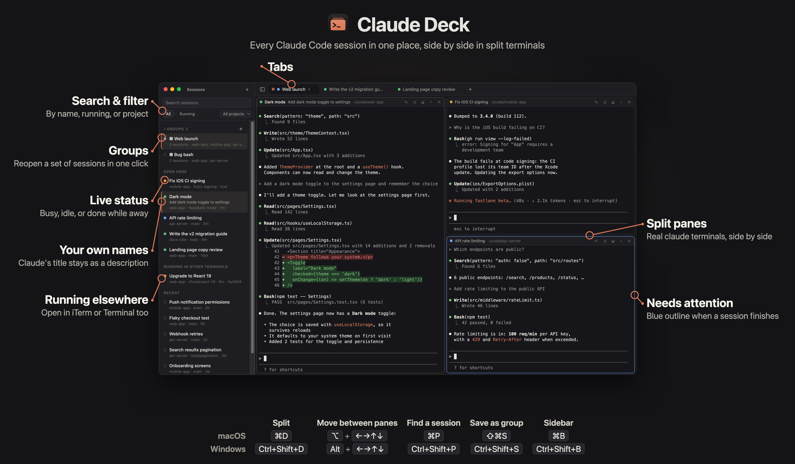

# Claude Deck

A desktop app for [Claude Code](https://claude.com/claude-code) CLI sessions. It lists every session on your machine, including ones running in other terminals. You can resume them in split terminal panes and tabs, and save sets of sessions as groups.



## Install

1. Install [Claude Code](https://claude.com/claude-code) first, and check that `claude` works in your terminal.
2. Download the latest zip from **[Releases](https://github.com/BatuhanSpyke/claude-deck/releases/latest)**:
   - Mac (Apple Silicon): `Claude-Deck-mac-arm64.zip`
   - Windows (x64): `Claude-Deck-windows-x64.zip`

**macOS**

1. Unzip it and drag **Claude Deck.app** into your **Applications** folder.
2. Open it. macOS will warn that it's from an unidentified developer, because the app isn't signed with an Apple developer certificate. Go to **System Settings → Privacy & Security**, scroll down and click **Open Anyway**. You only need to do this once.
   - Or run this in Terminal: `xattr -dr com.apple.quarantine "/Applications/Claude Deck.app"`

**Windows**

1. Unzip the folder anywhere, for example `C:\Users\<you>\Apps\Claude Deck`.
2. Run **Claude Deck.exe**. If SmartScreen says "Windows protected your PC", click **More info → Run anyway**.
3. Optional: right-click the exe and choose **Pin to Start** or **Pin to taskbar**.

**Updates**

Claude Deck checks GitHub for new releases every few hours. When one comes out, it asks whether to install it, and you can tick **Install updates automatically from now on**. You can change this any time under **Settings** (the gear in the tab bar, or ⌘, / Ctrl+,).

With automatic updates on, new releases download in the background. An **Update · Restart** button then appears in the tab bar. Click it, or keep working and the update installs the next time you quit. After a restart your tabs reopen and sessions resume.

On macOS this needs the app in a folder you can write to, such as **Applications**, not opened straight from Downloads.

## Features

- **All sessions in one sidebar.** It reads `~/.claude/projects` and `~/.claude/sessions` and shows titles, projects and live status (busy, idle, needs attention). It also shows sessions running in other terminals.
- **Real terminals.** Each pane runs `claude` in a real shell (xterm.js + node-pty). When Claude exits, you're left at a shell in the same folder.
- **Split panes and tabs.** Split right or down, drag dividers, maximize a pane, and move between panes with Option/Alt + arrows. Drag a pane by its title bar to move it, swap it with another, or send it to another tab.
- **Groups.** Save a tab's layout as a group. Opening it later resumes every session in its own folder.
- **Session names.** Give sessions your own names. Claude's title stays visible as a description.
- **Command palette** to jump to any session.

## Keyboard shortcuts

| Action | macOS | Windows |
| --- | --- | --- |
| New Claude session | ⌘N | Ctrl+Shift+N |
| New tab | ⌘T | Ctrl+Shift+T |
| Split right / down | ⌘D / ⇧⌘D | Ctrl+Shift+D / Ctrl+Shift+E |
| Close pane / tab | ⌘W / ⇧⌘W | Ctrl+Shift+W / Ctrl+Shift+Q |
| Move between panes (at the left/right edge: next tab) | ⌥ + arrows | Alt + arrows |
| Maximize pane | ⇧⌘↵ | Ctrl+Shift+Enter |
| Find session | ⌘P | Ctrl+Shift+P |
| Toggle sidebar | ⌘B | Ctrl+Shift+B |
| Rename session | ⇧⌘R | Ctrl+Shift+R |
| Save tab as group | ⇧⌘S | Ctrl+Shift+S |
| Go to tab 1–9 | ⌘1–9 | Ctrl+1–9 |
| Settings | ⌘, | Ctrl+, |
| Show all shortcuts | ⌘/ | Ctrl+Shift+/ |
| Copy / paste | ⌘C / ⌘V | Ctrl+C (with a selection) or Ctrl+Shift+C / Ctrl+V |

## Requirements

- Claude Code installed and on your `PATH` (`claude` must work in your normal terminal).
- macOS (Apple Silicon) or Windows 10/11 (x64). On Windows, sessions run in PowerShell 7 if it's installed, otherwise in Windows PowerShell.

## Development

```sh
npm install
npm start                 # run from source
npm run package           # macOS app   → dist/Claude Deck-darwin-arm64
npm run package:win       # Windows app → dist/Claude Deck-win32-x64 (needs Windows, or wine on macOS for the .exe icon)
```

GitHub Actions (`.github/workflows/build.yml`) builds both apps on every push. When you push a version tag like `v1.0.0`, it also attaches the zips to a GitHub Release.

The builds aren't code-signed. On macOS, right-click the app and choose **Open** the first time. On Windows, click **More info → Run anyway** in SmartScreen.

The icon source is `build/icon.svg`.
